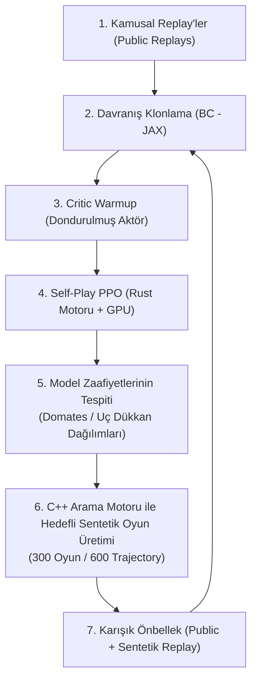
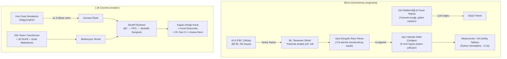

# Kaggriculture Post-Mortem: 1.lik Çözümünün Analizi ve Öğrenilen Dersler

Bu doküman, Kaggle **Kaggriculture** simülasyon yarışmasının tamamlanmasının ardından; yarışmayı 1. sırada tamamlayan **M & M & P & Q** takımının çözümü ([msdsm/kaggriculture-1st-solution](https://github.com/msdsm/kaggriculture-1st-solution) & [Writeup](https://kaggle.com/competitions/kaggriculture/writeups/1st-place-solution-our-journey-to-becoming-profe)) ile bu depoda geliştirilen çözümün ([ergousha/kaggriculture](https://github.com/ergousha/kaggriculture)) derinlemesine, teknik ve yapılandırılmış karşılaştırmalı retrospektifidir.

---

## 1. Yönetici Özeti (Executive Summary)

Kaggriculture, 720 adımlık (30 gün × 24 saat), 17'ye kadar işçi/çiftçi birimini yönetmeyi, dinamik fiyat eğrilerine sahip bir kasaba pazarını ve her 3 günde bir rastgele açılan dükkanları içeren çok katmanlı, stokastik bir kaynak yönetimi simülasyonuydu.

Bu projede (`ergousha/kaggriculture`), olağanüstü bir deneysel disiplin, istatistiksel titizlik (CRN, CVaR₅, panel kazanma oranı, LOO çapraz doğrulama) ve derinlemesine pazar madenciliği uygulanmış; ancak projenin erken aşamasında yaşanan bir başarısızlık (v0.0.8'deki ilkel BC modelinin çöküşü) makine öğreniminin tamamen terk edilmesine ve projenin **"Açık Döngülü Rota Tekrarı" (Open-Loop Route Replay)** yerel optimumuna hapsolmasına yol açmıştır.

Buna karşın yarışmayı kazanan ekip (**1st Place**), **Transformer mimarisi + İteratif Davranış Klonlama (BC) + Rust tabanlı yüksek hızlı motorla 11.9 Milyar adımlık Self-Play PPO + Kural Tabanlı Düzeltmeler + 29. Gün C++ Yerel Arama Devri** mimarisiyle uçtan uca kapalı döngü (closed-loop) öğrenme ile sezgisel sistemlerin kusursuz bir hibritini inşa etmiştir.

### Temel Karşılaştırma Tablosu

| Boyut | Bizim Yaklaşımımız (`ergousha`) | 1.lik Çözümü (`msdsm / M & M & P & Q`) | Stratejik Etki & Sonuç |
| :--- | :--- | :--- | :--- |
| **Ana Paradigma** | **Route-Replay / Metacounter:** 719 adımlık dondurulmuş aksiyon kaseti + sınırlı WEED onarımı + 64 dükkan çekilişi için rota seçimi. | **Hibrit Nöral-Arama:** 10.23M Transformer (BC + PPO) + Sezgisel aksiyon onarımı + 29. Gün C++ yerel arama devri (Agent A) / Sıralı maskeli PPO (Agent B). | Statik rota değişen pazar ve tohum koşullarında kırılgan kaldı; şampiyon her adımda dinamik tepki üretti. |
| **Öğrenme & Optimizasyon** | v0.0.8'de ilkel BC çöktü ($2.9k) $\rightarrow$ ML tamamen silindi. Sadece makro hiperparametreler CEM / Evrimsel Arama ile optimize edildi. | **BC $\leftrightarrow$ PPO $\leftrightarrow$ Sezgisel Döngüsü:** 11.9 Milyar ortam adımı (8.3M oyun), JAX + Rust motoru. Net2Net derinlik artırımı (6 $\rightarrow$ 12 blok). | Biz yerel rota mutasyonlarında tıkandık; şampiyon milyarlarca adımla taktiksel derinlik kazandı. |
| **Gözlem Temsili (Observation)** | v0.0.8'de eksik 4 boyutlu vektör (`[day, hour, money, hands]`). Sonrasında gözlem yalnızca dükkan algılama ve WEED onarımı için kullanıldı. | **264 Token $\times$ 124 Öznitelik:** Çiftlik kareleri (200), birimler (40), pazar slotları (10), emtialar (12), küresel durum ve rakip envanter hafızası. 2D RoPE uzamsal kodlama. | Şampiyon tam Markovyen durum temsili ve uzamsal dikkat kurarken, biz durumu gözlemlemeyi bıraktık. |
| **Aksiyon Temsili & Yönetimi** | İndirilen replay kasetinin ham aksiyonları. Değişiklik denemeleri (nakit takvimi, yol kısaltma) kural bağımlılıklarını bozdu. | **Sıralı Aksiyon Maskeleme (Sequential Masking):** Çiftçi ve işçiler sırayla seçilir; her seçim sonraki işçinin tohum ve kare havuzunu anlık maskeler. Mutlak SELL miktarı kafası (1-100). | Şampiyon birimler arası görev çakışmasını mimari düzeyde sıfırladı; biz kasetin hassas dengesine bağımlı kaldık. |
| **Pazar ve Ekonomi Yönetimi** | Kasetin nakit akışı harfiyen uygulandı. Süt bekletme (metering) ambar sınırı (100) yüzünden çöktü. | Nöral politika dinamik pazar emirleri üretir; kural katmanı ambar taşmasını gece öncesi satar, kritik ürünleri korur. | Şampiyon ambar kapasitesini (100) proaktif yönetti, satışı dinamik fiyatlara uydurdu. |
| **Oyun Sonu (Endgame)** | 718-719'da statik DROP/SELL. Kaset ne yaptıysa o tekrarlandı. | **Agent A:** 29. gün şafağında (son 24 saat) C++ Simulated Annealing motoruna devir teslim (~6 sn arama). Terminal nakit maksimizasyonu. | Arama doğru yerde kullanıldı: ufkun daraldığı, durumun deterministikleştiği son 24 saatte tam optimizasyon. |
| **Simülasyon Altyapısı** | Python `kaggle-environments` (~2.4s/oyun). 12 CPU worker ile günde on binlerce simülasyon. | **Rust Simülatörü (`native/engine`):** JAX ile GPU üzerinde paralel rollouts. 11.922.000.000 simülasyon adımı. | **100.000 kat hesaplama ölçeği farkı.** Simülatör hızı strateji alanının genişliğini belirledi. |
| **Metodoloji & Doğrulama** | Paired-seed CRN, CVaR₅, panel kazanma oranı, LOO çapraz doğrulama, winner's curse tespiti (Örnek teşkil edecek seviyede). | Eşdeğer seviyede doğrulama + PPO zayıflıklarını (domates/uç dükkanlar) tespit edip sentetik senaryo üretme disiplini. | Metodolojik titizliğimiz şampiyonla yarışacak düzeydeydi, ancak yanlış hipotez üzerinde işletildi. |

---

## 2. Şampiyon Çözümün Anatomisi (1st Place: Deep Dive)

Şampiyon ekibin çözümü, 4 uzmanın sinerjisiyle inşa edilmiştir:
- `@morim3`: Nöral ağ mimarisi ve 10M model serisi (daha çok self-play hipotezi).
- `@msdsm`: 20M model serisi ve Net2Net derinlik ölçekleme (daha çok parametre hipotezi).
- `@BergBuch`: C++ Sezgisel arama motoru (heuristic search planner).
- `@qistripute`: Kural tabanlı aksiyon yamaları ve replay analizi.

### 2.1. Ağ Mimarisi (10.23M Transformer & Token Şeması)
Şampiyonun final ajanı **10,225,070 parametrelik**, 12 bloklu, 256 genişliğinde, 8 dikkat başlıklı ve 2D RoPE (Rotary Position Embedding) kullanan bir Transformer omurgasına sahiptir:
- **Girdi Gözlemi (264 Token):**
  - **200 Hücre Token'ı (Her iki oyuncu):** $10 \times 10$ ızgaradaki her kare için 34 öznitelik (bitki türü, büyüme aşaması, sulama/gübrelenme durumu, yabani ot).
  - **40 Birim Token'ı (Her iki oyuncu):** 22 öznitelik (konum, taşınan envanter, rol).
  - **10 Pazar Emri Slotu:** 10 öznitelik.
  - **12 Emtia ve Hayvan Token'ı:** Fiyatlar, talep, doygunluk seviyeleri.
  - **1 Küresel Durum Token'ı:** Gün, saat, nakit, işçi sayısı.
  - **1 Rakip Envanter Bellek Token'ı:** Kamusal gözlemlerden (açık çiftlik, satın alımlar) kural tabanlı tahmin edilen gizli envanter olasılık dağılımı.
- **Uzamsal Kodlama (2D RoPE):** Çiftlik kareleri arasındaki nispi geometrik mesafeler 16 boyutlu 2D döner konum kodlaması ile verilmiştir.
- **Aksiyon Başlıkları:**
  - Birim başına 500 aksiyon logiti.
  - 10 Pazar slotu için ayrıştırılmış başlık: 1,003 standart işlem + **9 emtia $\times$ 100 miktar = mutlak SELL başlığı** (toplam 1,903 logit/slot).

### 2.2. İteratif Hibrit Eğitim Döngüsü (The Iterative Flywheel)
1.lik takımı tek bir eğitim yöntemi seçmek yerine birbirini besleyen bir döngü kurmuştur:

- **Ölçek:** Toplamda **8,290,767 PPO oyunu** ve **11,922,122,946 ortam adımı** (~11.9 Milyar adım).
- **Critic Isıtma:** PPO öncesi aktör dondurularak sadece değer ağı (critic) GAE ($\gamma=1, \lambda=0.97$) ile eğitilmiş, aktörün başlangıçta bozulması engellenmiştir.
- **Öğretmen Düzenlileştirmesi:** Katastrofik unutmayı önlemek için kayıp fonksiyonuna $0.2 \times \text{KL}(\pi_{\text{teacher}} \parallel \pi_{\text{policy}})$ eklenmiştir.
- **Net2Net Derinlik Büyütme:** 6 blokluk küçük model eğitildikten sonra ağırlıklar fonksiyon-koruyucu (function-preserving) sıfır-ilkleme ile 12 bloğa genişletilmiştir.

### 2.3. Sıralı Aksiyon Maskeleme (Sequential Action Masking - Agent B)
Ajanların aynı kareye gitmesi veya tohum miktarından fazla ekim emri verilmesi RL için büyük bir ceza kaynağıdır. Şampiyon bunu Agent B'de şu şekilde çözmüştür:
1. Önce çiftçinin aksiyonu seçilir.
2. Çiftçinin rezerve ettiği tohum ve hedef kare bir sonraki işçi için maskelenir.
3. Sırayla tüm işçiler bu dinamik maske altında kararlarını verir.
4. PPO log-olasılıkları da tam bu sıralı maskeleme yapısı altında optimize edilmiştir.

### 2.4. Oyun Sonu Arama Motoru Devri (Day 29 C++ Search Handoff - Agent A)
Agent A, oyunun 29. günü şafağında (adım 696-720) kontrolü bir C++ yerel arama motoruna devreder:
- 28. günde C++ kütüphanesi belleğe yüklenir.
- 29. günün ilk anında ~6 saniyelik bir arama bütçesiyle (simulated annealing, yeniden başlatmalı yerel arama) son 24 saatin tüm hasat, taşıma, bırakma ve pazar satışlarını birlikte çözer.
- Terminal nakit getirisini kuruşu kuruşuna maksimize eder.

---

## 3. Bizim Çözümümüzün Anatomisi ve Evrimi (`ergousha`)

Projemiz, baştan sona olağanüstü belgelenmiş ve ölçülmüş bir evrim geçirmiştir:

### 3.1. Faz 1: İki Katmanlı Kural Tabanlı Ajan (v0.0.1 - v0.0.6)
- **Makro Katman (`StrategicPlanner`):** Kare rollerini belirler, sermaye öncelik merdivenini yürütür (`engine_claim`).
- **Mikro Katman (`SpatialScheduler`):** Görevleri belirler ve greedy atama yapar.
- **Büyük Bulgu (Hungarian vs Greedy):** Jonker-Volgenant (Hungarian) eşleştirmesinin, greedy atamadan **%31 - %40 daha kötü** olduğu kanıtlandı. Çünkü greedy atama, boşta kalan işçileri ambar çevresinde bırakıyordu ve hayvan/yem lojistiği ambar çıkışlıydı!
- **Makro Arama:** 23 boyutlu strateji vektörü CEM (Cross-Entropy Method) ve Evrimsel Arama ile optimize edildi.

### 3.2. Faz 2: v0.0.8 Faciası ve ML'in Terk Edilmesi ($2.9k, 26× Kayıp)
v0.0.8 sürümünde tüm kural motoru atılıp PyTorch ile eğitilen ilkel bir BC modeli devreye alındı. Ajan, ortamın en basit `starter` botuna karşı bile 4 maçta 0 çekerek ortalama **$2,910** aldı (önceki sürüm $75,668 alıyordu).

Bu çöküşün gerçek sebepleri:
1. **Aksiyon uzayında `FEED`, `CARE`, `PICKUP` token'ları yoktu!** Bilinmeyen tüm aksiyonlar `0 = PASS` sınıfına atanmıştı. Ajan hayvanları besleyemiyordu.
2. **Durum uzayı Markovyen değildi:** Global vektör sadece `[day, hour, money, hands]` idi. Fiyatlar, ambar stoku, hayvan sayıları ve pazar durumu modele verilmemişti.
3. **Etiket çarpışması:** Birim aksiyonları $10 \times 10$ ızgarada pozisyona göre yazılmıştı. Aynı karedeki işçiler birbirinin etiketini eziyordu ve ızgaranın %84'ü `PASS` olduğu için model "her yerde PASS" demeyi öğrendi.
4. **Hatalı RL kurgusu:** Argmax çıkarımları bölüm ödülüyle ağırlıklandırılmıştı; değer ağı (critic) yoktu, GAE yoktu, 720 adımlık kredi ataması yoktu.

> **Kritik Kırılma Noktası:**
> Bu ağır hezimet sonrasında depoda şu genelleme yapıldı:
> *"56 bin doların üstü strateji değil; her basamak sabit bir plan ve ince bir onarım katmanından ibarettir... Öğrenme kapalı formu olmayan yere aittir. Mikro tam eşleştirmedir, makro 23 sayıdır. Atomik aksiyonları klonlamak gürültülü bir yaklaştırıcı koymaktır."*
>
> Tüm PyTorch/RL kodu silindi (`rm -rf rl/`) ve proje tamamen **Route Replay** çizgisine yöneldi.

### 3.3. Faz 3: Rota Tekrarı (Route Replay) ve Metacounter (v0.2.0 - v0.5.1)
- Liderlik tablosundan indirilen yüksek skorlu 719 adımlık bir aksiyon kaseti harfiyen replaying yapıldı.
- Referans merdivende skor bir anda 36'dan **60/60**'a çıktı.
- Ancak canlı maçlarda kasetin **stokastik pazar şoklarına karşı tamamen kırılgan** olduğu anlaşıldı. Aynı kaset şanslı tohumda $156k alırken, ters tohumda $73k alıyordu.
- Bu kırılganlığı aşmak için devasa bir madencilik ve eleme hattı kuruldu: 4,300+ aday incelendi, rakip paneline karşı CVaR ve kazanma oranı ile en sağlam kaset seçildi.
- Daha sonra **Metacounter** mimarisine geçildi (v0.4.0): 6. gündeki dükkan ikilisine göre (64 farklı olasılık) kaset değiştiren bir dükkan yönlendiricisi (`day-6 draw router`) eklendi.

### 3.4. Faz 4: Rota Sentezi ve Mikro Mutasyon Çıkmazı (Issue #26 - #30)
Dondurulmuş rotayı yerel olarak iyileştirmek için aksiyon uzayında mutasyon operatörleri denendi:
- **Issue #29 (Manhattan Yol Kısaltma):** Yürüme adımlarının %98.3'ünün zaten optimal olduğu, tasarruf edilen adımların sulama kotası yüzünden üretime dönüştürülemediği görüldü (Nötr sonuç).
- **Issue #30 (Süt Satışı Öteleme / Cash Metering):** Süt taban fiyatın %13'üne satılıyordu. Sütü depolayıp fiyat toparlanınca satma denendi. Ancak ambar sınırı (100) kilitlendi; süt depolamak değerli yün ve çileklerin ambardan taşarak yok olmasına yol açtı. Dahası, 927 emirden sadece 5 satış-alış çiftini birkaç adım ötelemek bile kazanma oranını %7.2 düşürdü. Rota, en ufak oynamada çöken aşırı hassas bir nakit takvimiydi.

### 3.5. Faz 5: 64 Çekiliş Tablosunun Refit Denemesi ve Kazananın Laneti
v0.5.2 aşamasında 64'lük dükkan tablosunu gerçek rakiplere karşı optimize etme deneyi yapıldı.
- Örneklem içi kazanç: **+$5,650 / çekiliş**.
- Leave-One-Out (LOO) çapraz doğrulamada sonuç: **-$151 / çekiliş**'e çöktü!
- 19 hücrenin 15'i katlar arasında kaset değiştirdi (saf gürültü).
- Tavan skora ulaşılmış, veri seti hacmi ve açık döngülü kaset paradigması sınırlarına dayanmıştı.

---

## 4. Karşılaştırmalı Analiz: Neyi Doğru, Neyi Yanlış ve Neyi Eksik Yaptık?

### 4.1. Neleri Çok Doğru Yaptık? (Strengths)

1. **Benzersiz Deneysel Disiplin ve İstatistiksel Olgunluk:**
   - **Ortak Rassal Sayılar (Common Random Numbers - CRN):** A/B testlerinde ve aramalarda rakipleri aynı tohumlarda eşleştirerek tohum şansını izole ettik.
   - **Metrik Evrimi:** Pazarın %86 ortak varyans olduğunu fark edip, yanıltıcı nakit ortalamasını terk ederek ikili kazanma oranına ve marj CVaR₅'e geçtik.
   - **Kazananın Laneti (Winner's Curse) Farkındalığı:** Seçilen adayların test tohumlarında ne kadar gerilediğini sürekli raporladık.
2. **Pazar Dinamiklerinin Matematiksel Olarak Çözülmesi:**
   - Yumurtanın stratejik olarak ayrışabilir (separable) ama ekonomik olarak bir aldatmaca (%0.6 pay) olduğunu kanıtladık.
   - Gübrelemenin satılmak yerine çileğe verilmesinin çarpan etkisini modelledik.
   - Pazarın tükenen bir havuz değil, kasaba talebiyle kendini yenileyen bir mekanizma olduğunu ortaya çıkardık.
   - `obs.private.shed`'in birim aksiyonlarından önce güncellendiğini (`observation ordering`) yakalayarak felaket bir envanter kesilmesini önledik.
3. **Mühendislik Standartları ve Güvenilirlik:**
   - Otomatik rakip arşivleme (`sync_opponent.py`) ile her sürüm sparring partner olarak saklandı.
   - `pre-flight` kontrolleri ile ortamın "son çağrılabilir fonksiyonu ajan kabul etme" tuzağı dahil tüm hatalar engellendi. Sıfır crash, sıfır timeout ile yarışıldı.

### 4.2. Neleri Yanlış Yaptık? (Critical Pitfalls)

1. **En Kritik Stratejik Hata: v0.0.8'deki Uygulama Kusurunu Paradigmanın Kusuru Zannetmek:**
   - v0.0.8'deki modelin çöküşü makine öğreniminin yetersizliğinden değil; **eksik aksiyonlar (`FEED`/`CARE` yok), eksik durum (fiyatsız gözlem), etiket çarpışması ve criticsiz avantaj ağırlıklandırması** gibi ilkel uygulama hatalarından kaynaklanıyordu.
   - Ancak bu teknik hata analiz edilip düzeltilmek yerine felsefi bir yargıya dönüştürüldü: *"Bu oyunda öğrenmeye yer yoktur, yukarısı sadece kaset tekrarıdır."*
   - Bu yanlış teşhis, bizi yarışmayı kazandıracak olan tek yoldan (RL ve Transformer) tamamen kopardı.
2. **Açık Döngü (Open-Loop) Rota Tekrarının Çıkmazına Saplanmak:**
   - Başka oyuncuların başarılı bir maçını kaset gibi baştan sona oynatmak, referans merdiveni geçse de doğası gereği kırılgandır.
   - Simülasyon her 3 günde bir rastgele dükkan açarken, 8-12 gün süren ürün yatırımlarını statik bir kasete bağlamak ajanı pazar şoklarına karşı kör bıraktı.
   - Metacounter ile 64 dükkan çekilişine 41 kaset atamak bu açık döngü problemini hafifletti ama çözemedi.
3. **Kırılgan Bir Nakit Çizelgesinde Lokal Arama Yapmaya Çalışmak:**
   - Issue #26-#30 boyunca dondurulmuş kasetin üzerinde mutasyonlar arandı. Ancak bir kaset, adım adım birbirine bağlı 458 emir ve binlerce hareketten oluşan rijit bir bütündür.
   - Sütü bekletmek ambarı tıkadı; 5 alım-satım emrini kaydırmak işçilerin tohumsuz kalmasına yol açtı. Değişkenlerin birbiriyle bu denli kenetlendiği açık döngülü bir yapıda yerel arama (local search) matematiksel olarak imkansızdı.
4. **"Gecikme (Latency) Yüzünden Uyarlama İmkansızdır" Yanılgısı:**
   - "Karar gecikmesi 8-12 gün, dükkan açılışı 3 gün, o halde kapalı döngü uyarlama yapılamaz, açık döngü tek dengedir" çıkarımı yapıldı.
   - Oysa kapalı döngü nöral politika anlık olarak ürün değiştirmek zorunda değildir; risk dengesini kurar, anlık fiyatlara göre hasat/satış önceliğini ayarlar, ambar kapasitesini yönetir ve yabani ot/işçi sapmalarını dinamik olarak telafi eder. Şampiyonun politikası tam olarak bunu başardı.

### 4.3. Neler Eksikti? (Gaps & Missed Opportunities)

1. **Hesaplama Motoru Asimetrisi (Python vs. Rust):**
   - Biz Python `kaggle-environments` ile oyun başına ~2.4 saniye harcarken; şampiyon ekip Rust ile yazılmış `kagg-engine` sayesinde saniyede binlerce adımı GPU'da simüle etti.
   - Şampiyon **11.9 Milyar adım** görürken, bizim simülasyon hacmimiz birkaç yüz bin adımda kaldı. Bu ~100.000 katlık deneyim farkı, taktiksel üstünlüğün anahtarı oldu.
2. **Çok Varlıklı (Multi-Entity) Transformer ve Uzamsal Temsil:**
   - Şampiyon çiftliği, birimleri ve pazarı 264 token'lık bir Transformer ile modeledi.
   - 2D RoPE ile uzamsal geometri doğal olarak öğrenildi. İşçilerin nerede durduğu, nereye gideceği nöral ağın dikkat katmanlarında çözüldü.
3. **Sıralı Aksiyon Maskeleme (Sequential Action Masking):**
   - Çok birimli (multi-agent) oyunlarda en büyük kriz olan "aynı tohumu/kareyi birden fazla birimin istemesi" sorununu, şampiyon işçileri sırayla seçip maskeleri anlık güncelleyerek mimaride çözdü.
4. **Aramanın Yalnızca Oyun Sonuna Odaklanması (Endgame Search Handoff):**
   - Tüm oyunu arama ile çözmek kombinatoryal patlama yüzünden imkansızdır.
   - Ancak ufkun 24 saate (24 adım) indiği 29. gün şafağında arama yapmak deterministiktir ve mükemmel çalışır. Şampiyonun Agent A'da yaptığı C++ devir teslimi tam olarak buydu.

---

## 5. Gelecek Yarışmalar İçin Çıkarılan Temel İlkeler (Actionable Takeaways)

Bu yarışmadan çıkarılan dersler, gelecekteki tüm karmaşık simülasyon ve RL yarışmaları için evrensel bir rehber niteliğindedir:

### İlke 1: Erken Başarısızlıklarda Yöntemi Değil, Uygulamayı Sorgula (Diagnose Bug vs Paradigm)
Bir makine öğrenimi veya RL denemesi ortamın en basit botuna karşı bile kaybediyorsa (%99 ihtimalle) problem o paradigmanın teorisinde değil; durum uzayının eksikliğinde (Markovyen olmaması), aksiyon sözlüğündeki bir bug'da veya kayıp fonksiyonundaki bir bozukluktadır. "Burada ML çalışmıyor" sonucuna varmadan önce durum, aksiyon ve gradyan akışı mikroskop altına alınmalıdır.

### İlke 2: Simülasyon Hızı Stratejiyi Belirler (Fast Simulator First)
Eğer bir ortamda RL veya yoğun arama yapılacaksa, Python simülatörüyle yola çıkmak baştan kaybetmektir. İlk 1-2 haftada Rust/C++ ile hafif ve hızlı bir simülasyon motoru yazmak; eğitim hacmini $10^5$ kat artırır. 11.9 Milyar adım gören bir ajan, 100 bin adım gören herhangi bir kural sistemini ezer.

### İlke 3: Açık Döngülü Rota Ezberi (Route Replay) Bir Yerel Optimum Tuzağıdır
Başka ajanların hareket kasetlerini harfiyen replaying yapmak hızlı bir liderlik tablosu sıçraması sağlar; ancak bu bir seraptır. Açık döngülü sistemler stokastik ortamlarda kırılgandır, pazar şoklarını ememez ve üzerlerinde yerel arama/mutasyon yapılamayacak kadar hassastır.

### İlke 4: Hibrit Sistemler Saf Sistemleri Döver (The Iterative Flywheel)
Ne "saf uçtan uca RL" ne de "saf el yazısı kurallar". Kazanan mimari:
- **BC:** Kamusal veriden hızlı temel taktik edinimi.
- **PPO:** Kendi kendine oynayarak (self-play) pazar temposunu ve mikro refleksleri geliştirme.
- **Sezgisel Motor:** Zayıf kalınan senaryoları (örneğin domates ağırlıklı dükkanlar) tespit edip bu durumlara özel sentetik veri üretme.
- **Kural Yamaları:** Ambar taşmasını ve kaynak çakışmasını mimari ve kural düzeyinde budama.

### İlke 5: Aramayı Zaman Ufkunun Kapandığı Yere Sakla (Search in the Endgame)
Oyunun başında ve ortasında arama yapmak pazarın stokastikliği yüzünden gürültü üretir. Ancak oyun sonuna yaklaşıldığında (örneğin son %5'lik dilim), belirsizlik sıfırlanır, hedef tekilleşir (tüm varlıkları nakde çevir). Bu noktada nöral politikadan C++ arama motoruna geçmek terminal skoru maksimize eder.
