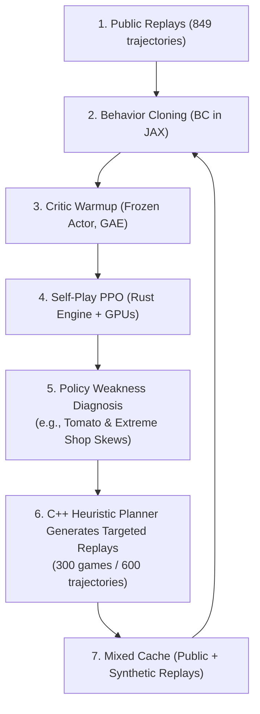

# Kaggriculture Post-Mortem: Analysis of the 1st Place Solution & Lessons Learned

This document provides an in-depth, technical, and comparative retrospective analyzing the winning solution by team **M & M & P & Q** ([msdsm/kaggriculture-1st-solution](https://github.com/msdsm/kaggriculture-1st-solution) & [Writeup](https://kaggle.com/competitions/kaggriculture/writeups/1st-place-solution-our-journey-to-becoming-profe)) against our codebase ([ergousha/kaggriculture](https://github.com/ergousha/kaggriculture)) following the conclusion of the Kaggle **Kaggriculture** competition.

---

## 1. Executive Summary

Kaggriculture is a 720-step (30 days × 24 hours), multi-agent resource management simulation involving up to 17 workers/farmers, dynamic commodity price curves, quadratic price penalties, and stochastic shop spawns every 3 days.

In this repository (`ergousha/kaggriculture`), we established rigorous empirical discipline, advanced statistical validation (Common Random Numbers, CVaR₅, opponent panel win rates, leave-one-out cross-validation), and extensive market data mining. However, an early catastrophic failure (the collapse of a naive Behavior Cloning model in v0.0.8) led to a premature theoretical generalization: concluding that machine learning had no place in this game and that top tiers were purely static scripts. Consequently, the project abandoned ML and became trapped in the **"Open-Loop Route Replay"** local optimum.

In stark contrast, the 1st place team constructed a masterclass hybrid architecture: **a 10.23M-parameter Transformer backbone trained with an alternating flywheel (Behavior Cloning $\leftrightarrow$ Self-Play PPO $\leftrightarrow$ Synthetic Heuristic Demonstrations across 11.9 Billion environment steps on a custom Rust simulation engine) + Rule-Based Action Patches + Day 29 C++ Simulated Annealing Search Handoff**.

### Comprehensive Comparison Matrix

| Dimension | Our Approach (`ergousha`) | 1st Place Solution (`msdsm / M & M & P & Q`) | Strategic Impact & Lessons |
| :--- | :--- | :--- | :--- |
| **Core Paradigm** | **Route-Replay / Metacounter:** Replaying a frozen 719-step action tape + minimal WEED repair + Day-6 shop-draw table across 64 pairs. | **Hybrid Neural-Search:** 10.23M Transformer (closed-loop BC + PPO) + rule-based repairs + Day 29 C++ local search handoff (Agent A) / Sequential action masks (Agent B). | Static replay was brittle against market and seed variations; the champion agent responded dynamically to live board and market states. |
| **Learning & Optimization** | Naive BC collapsed in v0.0.8 ($2.9k) $\rightarrow$ **ML was completely deleted**. Only 23 macro parameters searched via CEM / Evolutionary search. | **BC $\leftrightarrow$ PPO $\leftrightarrow$ Heuristics Flywheel:** 11.9 Billion environment steps (8.3M self-play games) in JAX + custom Rust engine (`kagg-engine`). Net2Net depth growth (6 $\rightarrow$ 12 blocks). | We hit a dead end trying to mutate static tapes; the champion attained massive tactical depth through billions of RL steps. |
| **Observation Representation** | v0.0.8 used an incomplete 4D vector (`[day, hour, money, hands]`). In route-replay, observation was only used for shop detection & weed repair. | **264 Tokens $\times$ 124 Features:** Farm tiles (200), units (40), market slots (10), commodities (12), global state, and opponent inventory tracker. 2D RoPE spatial encoding. | The champion learned spatial attention over a fully Markovian state; our model was blind to prices, inventories, and crop maturities. |
| **Action Space & Coordination** | Raw action tapes from mined replays. Local mutation attempts broke delicate order/cash dependencies. | **Sequential Action Masking:** Units sampled sequentially (farmer first, then hands); each unit's choice dynamically masks tiles and seed inventories for subsequent units. Absolute SELL quantity head (1-100). | The champion eliminated multi-unit action collisions at the architectural level; we remained hostage to the tape's rigid schedule. |
| **Market & Economy** | Exact execution of recorded cash schedules. Milk metering failed due to shed capacity (100) constraints. | Neural policy emits dynamic market orders; rule layer enforces pre-night liquidation of overflow above shed capacity (100) and endgame stock dumping. | The champion pro-actively managed shed capacity and dynamically aligned sales with live prices. |
| **Endgame Execution** | Static DROP/SELL on steps 717-719. Replayed verbatim from tape. | **Agent A:** At dawn of Day 29 (final 24 hours), control transfers to a C++ Simulated Annealing search engine (~6s search). Joint optimization of harvest, transport, and liquidation. | Search was applied where it belongs: in the endgame where the time horizon collapses and the environment becomes largely deterministic. |
| **Simulation Infrastructure** | Python `kaggle-environments` (~2.4s/game). 12 CPU workers running overnight sieves. | **High-Performance Rust Simulator (`native/engine`):** Zero-copy JAX GPU rollouts. **11,922,122,946 environment steps**. | **100,000× compute scale asymmetry.** Simulator throughput dictated the boundary of strategic exploration. |
| **Validation Methodology** | Paired-seed CRN, CVaR₅, opponent panel win rates, LOO cross-validation, winner's curse tracking (Industry-grade rigor). | Equivalent statistical rigor + targeted generation of synthetic shop scenarios (tomato / extreme distributions) to fix policy blind spots. | Our experimental rigor was world-class, but was applied to optimize an over-constrained, brittle hypothesis. |

---

## 2. Deep Dive: Anatomy of the 1st Place Solution

The 1st place team divided labor across 4 specialized sub-systems:
- `@morim3`: Neural architecture & 10M model line (scaling self-play games).
- `@msdsm`: 20M model line & Net2Net depth growth (scaling parameter capacity).
- `@BergBuch`: C++ heuristic planner & local search engine.
- `@qistripute`: Rule-based action patches, shed overflow logic, and replay analytics.

### 2.1. Transformer Architecture & Tokenization
The final neural network has **10,225,070 parameters** (12 blocks, width 256, 8 attention heads, 256 $\rightarrow$ 1,024 $\rightarrow$ 256 GELU FFN):
- **Structured Token Input (264 Tokens $\times$ 124 Features):**
  - **200 Farm Cells (Both players):** 34 features per tile (crop type, maturity, hydration/fertilization counters, decay countdown, weeds, occupancy).
  - **40 Units (Both players):** 22 features per unit (position, carried items, worker index, role).
  - **10 Market Slots:** 10 features per slot.
  - **12 Commodities & Animals:** Price trajectories, town consumption rate, market saturation.
  - **1 Global State Token:** Season/day progress, money, hiring count, unlocked quadrants, active shops, remaining shed capacity (`shed_room`), pending overflow.
  - **1 Opponent Inventory Memory Token:** Public observation belief tracker estimating the opponent's hidden carried inventory and shed distribution.
- **2D RoPE (Rotary Position Embedding):** Encodes 2D geometric grid coordinates into attention heads, allowing attention to naturally perceive spatial distances.
- **Action Heads:**
  - 500 action logits per unit.
  - 10 Market slots with an absolute SELL-quantity head: 1,003 non-SELL choices + 9 commodities $\times$ 100 discrete quantities = 1,903 decoded choices per slot.

### 2.2. The Iterative Training Flywheel
Rather than choosing between RL, imitation learning, or search, the champion used an alternating training flywheel:

- **Massive Experience:** Over **8,290,767 PPO games** and **11.92 Billion environment steps**.
- **Critic Warmup:** To prevent policy degradation when starting PPO after BC, the actor was frozen while the critic was fitted using GAE ($\gamma=1.0, \lambda=0.97$).
- **Teacher Regularization:** Policy collapse was prevented by including a KL regularizer: $0.2 \times \text{KL}(\pi_{\text{teacher}} \parallel \pi_{\text{policy}})$.
- **Net2Net Depth Growth:** Function-preserving weight expansion allowed initializing a 12-block model seamlessly from a converged 6-block model.

### 2.3. Sequential Action Masking (Agent B)
In multi-unit games, multi-agent coordination often suffers from units requesting the same resource or tile simultaneously. Agent B solved this inside JAX:
1. The farmer chooses an action first.
2. The chosen tile and seed reservations dynamically update masks for Hand 1.
3. Units choose sequentially, each conditioned on the updated legal mask.
4. Sampling and PPO log-probabilities were computed with these exact conditional masks.

### 2.4. Endgame C++ Search Handoff (Agent A)
Agent A relies on the neural policy for Days 0–28. At dawn of Day 29 (the final 24 hours):
- The C++ library (`terminal_search.so`) is pre-loaded on Day 28.
- On Day 29 dawn, if overage time is sufficient (>10s), the controller switches to a C++ Simulated Annealing search engine.
- For ~6 seconds, the planner jointly optimizes all task assignments, pathing, harvesting, ferrying, and liquidation to maximize terminal cash down to the cent.
- If overage is low or loading fails, it safely falls back to the neural policy.

---

## 3. Retrospective: What We Did Right, What We Did Wrong, and What We Missed

### 3.1. What We Did Right (Strengths)

1. **Flawless Empirical & Statistical Discipline:**
   - **Common Random Numbers (CRN):** All A/B evaluations and CEM parameter searches used strictly paired seeds across both seat positions.
   - **P(win) & Margin CVaR₅ Formulation:** Recognized that cash was 86% common-mode variance caused by shared shop draws. Pivoted selection from own-cash to head-to-head win rate and margin CVaR₅ against an opponent panel.
   - **Winner's Curse Awareness:** Faithfully measured and reported shrinkage between selection seeds and held-out seeds.
2. **Deep Economic & Game Mechanics Analysis:**
   - Mined daily Kaggle dumps to prove that EGG was an economic trap (0.6% revenue share in the top decile), despite flat price curves.
   - Mathematically proved that applying fertilizer to strawberries yielded 2× production, vastly outperforming selling raw fertilizer.
   - Discovered that `obs.private.shed` reflects the state *prior* to unit actions, preventing catastrophic inventory truncation bugs.
3. **Software Engineering Standards:**
   - Pre-commit hooks (`sync_opponent.py`) automatically versioned every submission into `opponents/vX_Y_Z.py` as sparring partners.
   - Strict pre-flight checks eliminated environment quirks (such as Kaggle evaluating the *last callable* in the file). Zero crashes and zero timeouts across all official submissions.

### 3.2. What We Did Wrong (Critical Pitfalls)

1. **The Fatal Misdiagnosis of v0.0.8 (Premature Abandonment of ML):**
   - In v0.0.8, a naive Behavior Cloning model collapsed against the environment's starter bot ($2,910 vs $75,668).
   - This failure was entirely due to basic bugs and architectural flaws:
     - The action space lacked `FEED`, `CARE`, and `PICKUP` tokens (mapped to `PASS`).
     - State was non-Markovian: 4 scalar numbers (`[day, hour, money, hands]`), completely omitting market prices, inventories, crop stages, and animal counts.
     - Spatial label collisions on a $10 \times 10$ grid caused 84% `PASS` bias.
     - Unsound RL loop: argmax rollouts weighted by episode return without a critic or GAE.
   - **The Mistake:** Instead of diagnosing these implementation flaws, the project concluded:
     > *"Above ~$56k this is not a strategy competition — every ladder rung above 5, and the current #1, is a fixed plan with a thin repair layer... learning has no place here."*
   - All ML code was deleted (`rm -rf rl/`), locking the project into the open-loop replay paradigm, while the winner proved that Transformer + PPO was the ultimate winning strategy.
2. **Getting Trapped in the Open-Loop Route-Replay Paradigm:**
   - Replaying a static 719-step action tape increased the reference ladder score from 36 to 60/60, creating a false illusion of mastery.
   - However, an open-loop tape is inherently blind to environment stochasticity. Shops spawn randomly every 3 days; an 8-12 day crop cycle tied to a static tape is completely exposed to adverse market draws.
3. **Searching Over a Brittle Cash Schedule (Issues #26–#30):**
   - Weeks were spent attempting to mutate the recorded tape (Manhattan path shortening, milk sales metering).
   - But a mined tape is a tightly coupled, over-tuned cash schedule: 319 of 458 funded orders cannot be delayed by a single step. Shifting just 5 market orders out of 927 degraded panel win rate by 7.2%.
4. **The False Latency Dichotomy:**
   - We reasoned: *"Decision latency is 8-12 days, shop respawn is 3 days, therefore closed-loop adaptation is impossible and open-loop is the equilibrium."*
   - This was a false dilemma. A closed-loop policy does not need to abandon a crop mid-growth; it dynamically manages portfolio risk, shifts harvesting and selling priorities based on spot prices, manages shed headroom, and absorbs weed/worker perturbations.

### 3.3. What We Missed (Gaps & Scale Asymmetry)

1. **Compute Engine Asymmetry (Python vs. Rust):**
   - We simulated in standard Python `kaggle-environments` (~2.4s per game). A 12-worker CPU overnight run processed at most a few tens of thousands of games.
   - The 1st place team built `kagg-engine` in Rust with zero-copy JAX bindings, simulating **11.92 Billion steps** (~100,000× more experience). Simulation speed set the horizon of strategic possibility.
2. **Multi-Entity Transformer with 2D RoPE:**
   - The winner represented the full spatial environment via 264 tokens, enabling self-attention across cells, units, and market slots.
3. **Sequential Action Masking:**
   - Solved multi-unit spatial and resource conflicts cleanly inside the policy forward pass rather than relying on brittle greedy heuristics or Hungarian matching.
4. **Endgame-Only Local Search:**
   - Rather than attempting to optimize an intractable 720-step schedule, the winner restricted search to the deterministic 24-step endgame (Day 29), extracting maximum value when it mattered most.

---

## 4. Five Actionable Principles for Future Competitions

1. **Principle 1 (Diagnose the Bug, Not the Paradigm):**
   If an ML/RL baseline fails against a trivial starter bot, the failure is almost certainly an implementation bug (missing action tokens, non-Markovian state, broken loss function), not a proof that ML is unviable. Never abandon a paradigm without a rigorous audit of state, action, and gradient flow.
2. **Principle 2 (Fast Simulator First):**
   In simulation and RL competitions, invest the first 1-2 weeks in building a high-speed simulation engine in Rust, C++, or JAX. An agent trained on 11 billion steps will overwhelmingly defeat hand-crafted rules trained on 100 thousand steps.
3. **Principle 3 (Open-Loop Replay is a Local Optimum):**
   Replaying elite action traces provides an easy early boost on static benchmarks, but creates a fragile agent incapable of handling stochastic shocks or adversarial counter-play.
4. **Principle 4 (The Hybrid Flywheel Wins):**
   Do not treat RL, imitation learning, heuristics, and search as mutually exclusive. The winning strategy is an iterative flywheel:
   `BC (bootstrap) ➔ PPO (self-play expansion) ➔ Heuristic synthetic generation (patching blind spots) ➔ BC refinement ➔ Rule-based runtime guards`.
5. **Principle 5 (Reserve Search for Collapsed Horizons):**
   Combinatorial search over long stochastic horizons is noisy and intractable. Restrict local search to the endgame (the final 5-10% of steps) where uncertainty collapses and terminal value can be greedily extracted.
